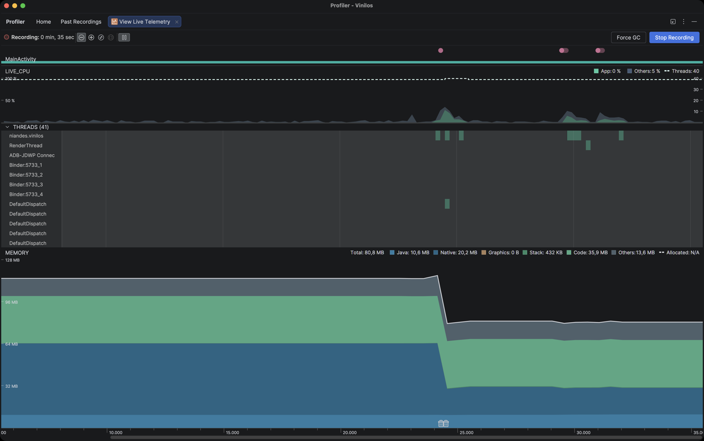
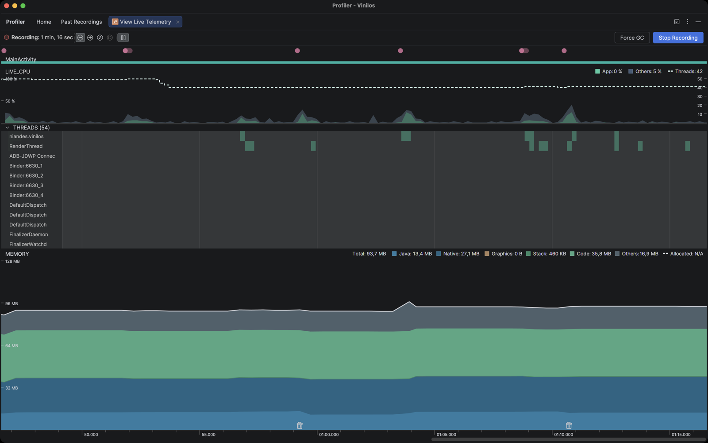
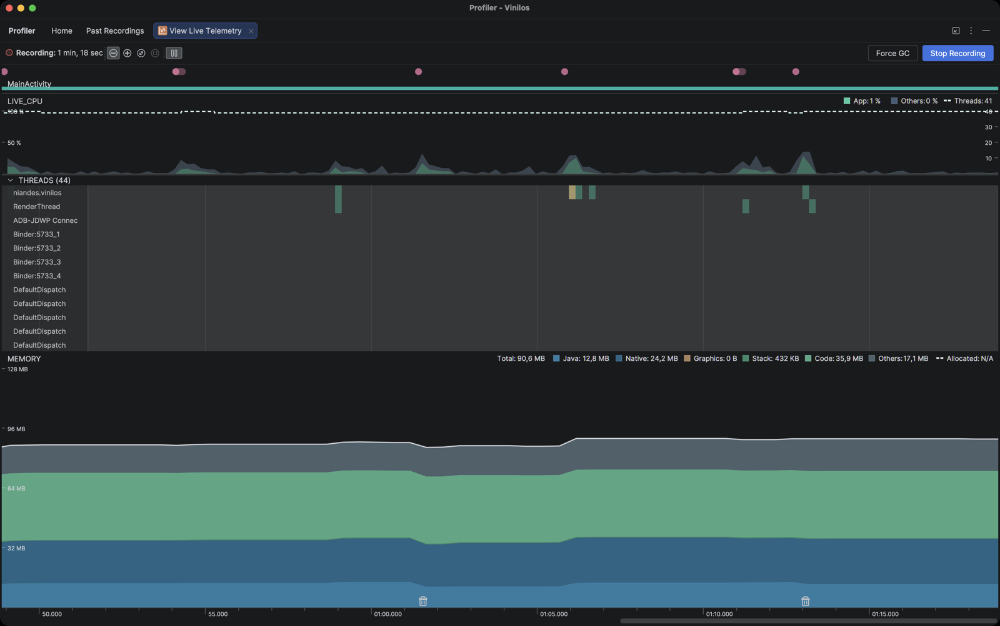
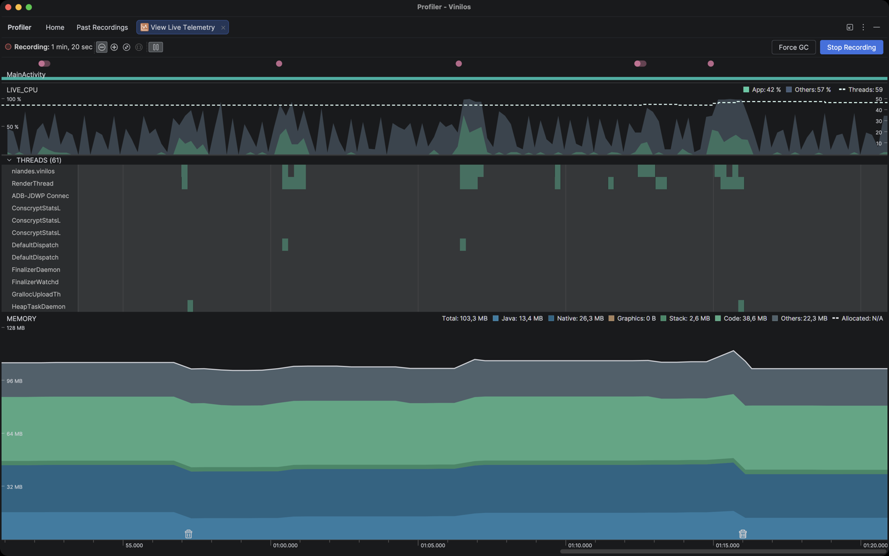
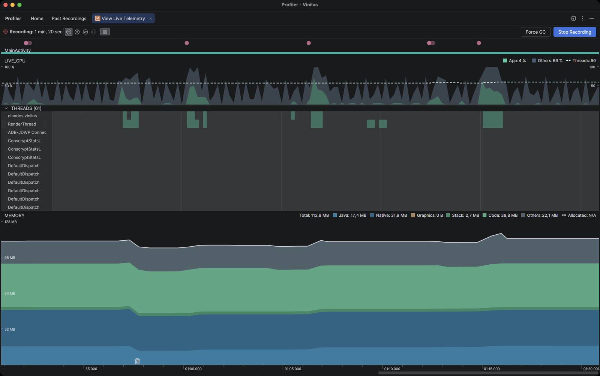
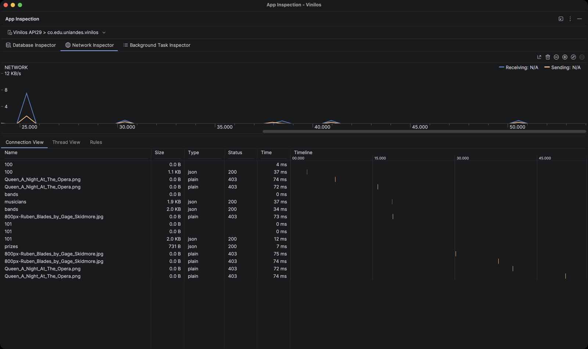

# Reporte de perfilamiento — Sprint 2

Perfilamiento de las historias de usuario de las iteraciones 1 y 2 (HU01, HU02, HU03, HU04 y HU07), y de las adelantadas del Sprint 3 (HU05, HU06 y HU08), antes y después de las optimizaciones del Sprint 2.

**Conclusión:** en el APK que se entrega, las optimizaciones reducen la memoria total (PSS) entre 13 % y 24 % en Android 10 y 17, y el heap de Java entre 33 % y 48 % en Android 5.1. Tras 5 vueltas seguidas la memoria se estabiliza más abajo que antes (Android 17: de 68 a 50 MB). La CPU baja en todas las historias en Android 10 y 17, y el arranque en frío mejora entre 13 % y 19 %. En Android 10 desaparecen los tirones del detalle de álbum y del listado de artistas. En la red, la caché evita repetir consultas al volver a una pantalla, y músicos y bandas se piden en paralelo.

Hay dos resultados que no van en la misma dirección, y se reportan tal cual. En Android 5.1 la CPU sube en algunas historias. En el Profiler de Android 17, con el APK de depuración, la memoria del "después" es igual o hasta 9,6 MB mayor, porque la caché retiene las respuestas a propósito. Las secciones 3, 6 y 7 los explican.

## 1. Qué se comparó

| Versión | Código | Qué incluye |
|---|---|---|
| **Antes** | `develop` en el commit [`8fc05b9`](https://github.com/AJDeLavalle/App-Vinilos-movil/commit/8fc05b9) | Las 8 HU, con los arreglos del code review y sin optimizaciones |
| **Después** | `develop` tras [#74](https://github.com/AJDeLavalle/App-Vinilos-movil/pull/74), [#76](https://github.com/AJDeLavalle/App-Vinilos-movil/pull/76), [#78](https://github.com/AJDeLavalle/App-Vinilos-movil/pull/78) y [#79](https://github.com/AJDeLavalle/App-Vinilos-movil/pull/79) | Micro-optimizaciones, corrutinas en paralelo, caché acotada, un solo cliente HTTP, Coil configurado y R8 |

El detalle de cada optimización está en [Micro‐optimizaciones — Sprint 2](https://github.com/AJDeLavalle/App-Vinilos-movil/wiki/Micro‐optimizaciones-—-Sprint-2).

## 2. Cómo se midió

Se usaron dos herramientas que se complementan.

**Android Studio Profiler**, la herramienta del codelab *Perfilamiento de apps Android*:

- **Live Telemetry:** CPU de la app, hilos y memoria por categoría (Java, nativa, gráficos, stack y código).
- **App Inspection → Network Inspector:** peticiones HTTP, su tamaño, su código de respuesta y su tiempo.
- Se usó en Android 10 (API 29) y Android 17 (API 37), con los APK de depuración de cada versión. El Profiler exige API 26 o superior, así que no se puede usar en Android 5.1.
- Se recorrió cada historia y se capturó la ventana del Profiler al terminarla.

**Script [`perfilar-hu.sh`](../perfilar-hu.sh)**, para cifras comparables en los tres dispositivos:

- **Qué recorre:** HU01 a HU08 por `adb`, sin escribir en el backend. Los formularios se abren y se validan, pero no se guardan.
- **Qué registra al terminar cada historia:**
  - memoria con `dumpsys meminfo` (PSS total, heap de Java y heap nativo);
  - fluidez con `dumpsys gfxinfo` (fotogramas, porcentaje con tirones, percentiles 50 y 90);
  - CPU consumida por la app, a partir de `/proc/<pid>/stat`.
- **Además mide:** el arranque en frío y en caliente con `am start -W` (mediana de 5), y la memoria en 5 vueltas seguidas por las pantallas de consulta, para detectar fugas.
- **Qué APK usa:** el build type `perfil`. Es igual al release (con R8 en la versión "después" y sin depuración), pero apunta a BackVynils local, así la latencia variable de la nube no contamina la comparación.

**Dispositivos:** tres emuladores, que cubren el mínimo soportado, una versión intermedia y la más reciente. No se usaron dispositivos físicos: fue una decisión del equipo para esta iteración.

| Dispositivo | Android | API | Resolución |
|---|---|---|---|
| Emulador Pixel 2 | 5.1.1 | 22 | 1080 × 1920 |
| Emulador Pixel 4 | 10 | 29 | 1080 × 2280 |
| Emulador Medium Phone | 17 | 37 | 1080 × 2400 |

Datos crudos: [`perfilamiento/`](perfilamiento/) (un CSV por dispositivo y versión, más las cifras leídas del Profiler).

## 3. Android Studio Profiler

### 3.1 API 29 (Android 10)

Memoria total de la app al terminar cada historia, leída de Live Telemetry (APK de depuración):

| HU | Antes | Después | Diferencia |
|---|---|---|---|
| HU01 Catálogo | 114,2 MB | 114,1 MB | −0,1 MB |
| HU02 Detalle de álbum | 83,8 MB | 80,8 MB | −3,0 MB |
| HU03 Artistas | 88,8 MB | 86,0 MB | −2,8 MB |
| HU04 Detalle de artista | 90,2 MB | 87,7 MB | −2,5 MB |
| HU07 Crear álbum | 93,7 MB | 90,6 MB | −3,1 MB |

La diferencia viene casi toda de la memoria nativa (de 21,6–27,1 MB a 20,2–24,2 MB). Es menor que la del script porque el APK de depuración no lleva R8 ni la configuración de Coil en caché de disco.

| Antes | Después |
|---|---|
|  |  |
|  |  |

Cómo leer las capturas:

- Los puntos rosados de la fila superior son los toques.
- Cada pico de CPU coincide con la carga de una pantalla.
- En la lista de hilos, `DefaultDispatcher` son los hilos de las corrutinas (`Dispatchers.IO`) que hacen la red. El hilo principal (`niandes.vinilos`) solo tiene ráfagas cortas, sin bloqueos largos, que es lo que evita un ANR.
- Los iconos de papelera sobre la memoria marcan las recolecciones de basura.

Todas las capturas, de las 5 HU antes y después, están en [`profiler/`](profiler/) (prefijo `api29-`).

### 3.2 API 37 (Android 17)

| HU | Antes | Después | Diferencia | Java antes → después |
|---|---|---|---|---|
| HU01 Catálogo | 101,7 MB | 102,3 MB | +0,6 MB | 12,2 → 12,2 MB |
| HU02 Detalle de álbum | 105,7 MB | 105,7 MB | 0 MB | 13,8 → 13,9 MB |
| HU03 Artistas | 104,7 MB | 109,2 MB | +4,5 MB | 15,8 → 15,8 MB |
| HU04 Detalle de artista | 107,0 MB | 110,7 MB | +3,7 MB | 16,9 → 16,9 MB |
| HU07 Crear álbum | 103,3 MB | 112,9 MB | +9,6 MB | 13,4 → 17,4 MB |

En Android 17, con el APK de depuración, la memoria del "después" es igual o mayor. La explicación más probable es la caché en memoria de [#78](https://github.com/AJDeLavalle/App-Vinilos-movil/pull/78): retiene a propósito los álbumes y artistas ya descargados (hasta 20 detalles por repositorio, y vencen a los 2 minutos) para no volver a pedirlos. En HU07 se suma la lista de artistas que el formulario reutiliza. Es un intercambio deliberado de memoria por red, con un costo acotado. El APK de depuración tampoco tiene R8. En el APK `perfil`, medido con el script en el mismo emulador (sección 4), la memoria total sí baja entre 13 % y 24 %.

| Antes | Después |
|---|---|
|  |  |

Capturas completas en [`profiler/`](profiler/) (prefijo `api37-`).

## 4. Resultados por dispositivo (script)

APK `perfil` (igual al release). En API 22 el emulador no calcula PSS ni tirones, así que se compara el heap de Java asignado. Δ negativo es mejora.

#### API 22

Arranque en frío: 231 ms → 202 ms. En caliente: 48 ms → 51 ms (mediana de 5).

| HU | Heap de Java (MB) antes | después | Δ | CPU antes (ms) | después | Δ |
|---|---|---|---|---|---|---|
| HU01 Catálogo | 10,6 | 6,1 | -42 % | 470 | 610 | +30 % |
| HU02 Detalle de álbum | 13,6 | 7,6 | -44 % | 600 | 600 | +0 % |
| HU03 Artistas | 15,0 | 8,7 | -42 % | 220 | 170 | -23 % |
| HU04 Detalle de artista | 14,3 | 8,2 | -43 % | 430 | 560 | +30 % |
| HU07 Crear álbum | 15,3 | 10,2 | -33 % | 670 | 770 | +15 % |
| HU05 Coleccionistas | 13,7 | 7,4 | -46 % | 130 | 140 | +8 % |
| HU06 Detalle de coleccionista | 13,8 | 7,6 | -45 % | 220 | 250 | +14 % |
| HU08 Asociar track | 14,8 | 7,7 | -48 % | 780 | 1020 | +31 % |

Fugas: heap de java en 5 vueltas por las pantallas de consulta: antes 17,3, 17,4, 19,1, 17,7, 19,6 MB; después 9,5, 12,6, 12,7, 12,2, 11,1 MB.

#### API 29

Arranque en frío: 251 ms → 204 ms. En caliente: 55 ms → 59 ms (mediana de 5).

| HU | PSS (MB) antes | después | Δ | CPU antes (ms) | después | Δ | Tirones antes | después |
|---|---|---|---|---|---|---|---|---|
| HU01 Catálogo | 63,5 | 54,4 | -14 % | 980 | 940 | -4 % | 1,3 % | 0,9 % |
| HU02 Detalle de álbum | 59,6 | 47,4 | -20 % | 1100 | 1050 | -5 % | 22,5 % | 0,0 % |
| HU03 Artistas | 59,6 | 48,0 | -19 % | 370 | 330 | -11 % | 88,9 % | 0,0 % |
| HU04 Detalle de artista | 60,4 | 49,1 | -19 % | 760 | 730 | -4 % | 0,0 % | 0,0 % |
| HU07 Crear álbum | 60,6 | 49,0 | -19 % | 1350 | 1190 | -12 % | 27,0 % | 19,4 % |
| HU05 Coleccionistas | 59,0 | 48,8 | -17 % | 290 | 230 | -21 % | 0,0 % | 0,0 % |
| HU06 Detalle de coleccionista | 59,5 | 49,2 | -17 % | 380 | 380 | +0 % | 0,0 % | 0,0 % |
| HU08 Asociar track | 63,4 | 48,1 | -24 % | 1350 | 1200 | -11 % | 0,0 % | 2,7 % |

Fugas: pss en 5 vueltas por las pantallas de consulta: antes 67,7, 72,8, 71,8, 71,6, 72,4 MB; después 54,1, 56,9, 49,5, 57,7, 56,5 MB.

#### API 37

Arranque en frío: 312 ms → 260 ms. En caliente: 47 ms → 44 ms (mediana de 5).

| HU | PSS (MB) antes | después | Δ | CPU antes (ms) | después | Δ | Tirones antes | después |
|---|---|---|---|---|---|---|---|---|
| HU01 Catálogo | 64,8 | 49,3 | -24 % | 710 | 670 | -6 % | 5,6 % | 4,8 % |
| HU02 Detalle de álbum | 76,1 | 60,2 | -21 % | 770 | 690 | -10 % | 4,7 % | 4,1 % |
| HU03 Artistas | 75,5 | 59,6 | -21 % | 270 | 230 | -15 % | 8,0 % | 3,8 % |
| HU04 Detalle de artista | 76,9 | 59,1 | -23 % | 590 | 520 | -12 % | 3,5 % | 5,8 % |
| HU07 Crear álbum | 72,0 | 59,0 | -18 % | 1240 | 1060 | -15 % | 8,4 % | 6,0 % |
| HU05 Coleccionistas | 77,7 | 59,5 | -23 % | 260 | 240 | -8 % | 3,9 % | 1,9 % |
| HU06 Detalle de coleccionista | 77,3 | 59,0 | -24 % | 470 | 450 | -4 % | 3,5 % | 3,5 % |
| HU08 Asociar track | 66,6 | 57,7 | -13 % | 1490 | 1320 | -11 % | 5,1 % | 3,3 % |

Fugas: pss en 5 vueltas por las pantallas de consulta: antes 67,9, 68,4, 68,2, 68,4, 68,8 MB; después 49,1, 51,0, 50,4, 50,5, 50,6 MB.

## 5. Red (Network Inspector, API 29)



Se recorrió dos veces cada detalle: álbum, Queen, el listado de artistas y el formulario de crear álbum.

- **Caché:** `/albums/100`, `/bands/101` y `/prizes` se pidieron **una sola vez**. La segunda visita salió de la caché en memoria ([#78](https://github.com/AJDeLavalle/App-Vinilos-movil/pull/78)). El formulario de crear álbum reutilizó la lista de artistas.
- **Paralelismo:** `musicians` y `bands` salen en el mismo instante de la línea de tiempo ([#76](https://github.com/AJDeLavalle/App-Vinilos-movil/pull/76)).
- **Hallazgo:** las imágenes alojadas en Wikimedia responden **403** y se vuelven a pedir en cada visita. Se reportó como [DEF-08 (#83)](https://github.com/AJDeLavalle/App-Vinilos-movil/issues/83).

## 6. Hallazgos

| # | Hallazgo | Evidencia | Acción |
|---|---|---|---|
| 1 | En el APK que se entrega, la memoria baja en todas las HU: entre −13 % y −24 % de PSS en API 29 y 37, y entre −33 % y −48 % de heap de Java en API 22 | Sección 4 | Mantener R8, la caché acotada y Coil configurado |
| 1b | En el APK de depuración en API 37 la memoria sube hasta +9,6 MB: la caché retiene respuestas a propósito | Sección 3.2 | Revisar en el Sprint 3 si 20 detalles por repositorio es demasiado; se puede bajar el máximo sin tocar nada más |
| 2 | Sin señales de fuga: en 5 vueltas la memoria se estabiliza en lugar de crecer, y queda más baja que antes | Sección 4, fila "Fugas" | — |
| 3 | En API 29 desaparecen los tirones del detalle de álbum (22,5 % → 0 %) y del listado de artistas (88,9 % → 0 %) | Sección 4 | — |
| 4 | El formulario de crear álbum sigue con tirones (≈ 19 % en API 29), al abrir el teclado | Sección 4 | Revisar en el Sprint 3 con System Trace |
| 5 | En API 22 la CPU sube en algunas HU (hasta +31 %) aunque la memoria baja; en API 29 y 37 la CPU baja en todas | Sección 4 | Es una sola corrida. Hipótesis por confirmar: las peticiones en paralelo concentran trabajo en un procesador más lento |
| 6 | Imágenes de Wikimedia con 403, que se piden en cada visita | Sección 5 | [DEF-08 (#83)](https://github.com/AJDeLavalle/App-Vinilos-movil/issues/83) |
| 7 | El hilo principal no tiene bloqueos largos: la red corre en hilos de corrutinas, y StrictMode no registra violaciones | Sección 3 y [#76](https://github.com/AJDeLavalle/App-Vinilos-movil/pull/76) | — |

## 7. Límites

- **Emuladores, no dispositivos físicos.** Los valores absolutos de CPU y fluidez cambian en un teléfono real; la comparación antes/después sí es válida porque usa el mismo emulador.
- **Una corrida por versión y dispositivo.** Las cifras de CPU y de tirones tienen ruido. La memoria es la medida más estable.
- **Android 5.1 en emulador** no calcula el PSS ni las estadísticas de tirones. Allí se usa el heap de Java asignado, que sí está disponible.
- **El Profiler se usó con APK de depuración**, porque es lo que permite adjuntarse al proceso. El script usa APK con R8, así que sus diferencias son mayores.
- **Backend local** en el script y en el Profiler. La latencia de Heroku no está incluida.

## 8. Cómo repetirlo

```bash
./gradlew assemblePerfil
```

```bash
ANDROID_SERIAL=emulator-5554 ./docs/desempeno/perfilar-hu.sh app/build/outputs/apk/perfil/app-perfil.apk despues > despues.csv
```

Para el "antes", compilar el mismo build type en el commit `8fc05b9`. Para el Profiler: **View → Tool Windows → Profiler**, elegir el proceso `co.edu.uniandes.vinilos`, la tarea **View Live Telemetry** y **Start profiler task from: Now**.
